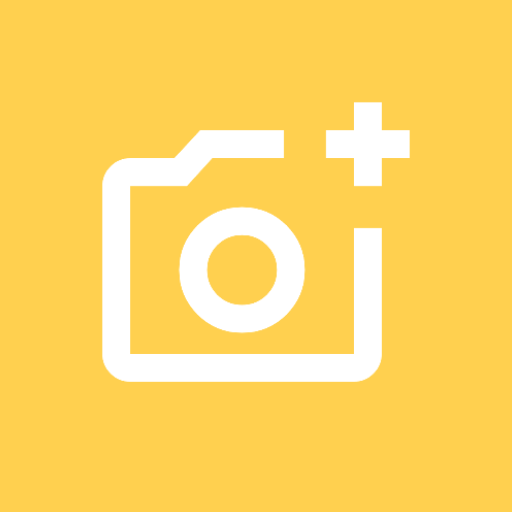

  

# Camera Control

An Android app that controls a Nikon DSLR over USB, using PTP. Plug the camera into your phone with an OTG cable and you can change settings and fire the shutter from the phone.

## What it does

- Connects to Nikon cameras over USB (vendor ID `0x04B0`)
- Shows a live readout with battery level, ISO, aperture, shutter speed and exposure compensation
- Changes those settings and triggers the shutter
- Gallery that browses the SD card and pulls full files off the camera
- Helpers:
  - **HDR bracketing**: 3 shots at -2 / 0 / +2 EV
  - **Astrophotography preset**: ISO 1600, EV 0, widest aperture, longest shutter up to 30s (put the camera in M mode first)

## Requirements

- Android 15 or newer (`minSdk 35`)
- A Nikon camera that speaks PTP over USB
- A USB OTG cable

## Building

Open the project in Android Studio and run the `app` module. You can also run `./gradlew assembleDebug` from the command line.

## Notes

- Tested only on the camera I own, so other models may behave differently.
- The HDR helper currently sets ISO to 400. That's hardcoded for now.

## License

GPL-3.0. See [LICENSE](LICENSE).
